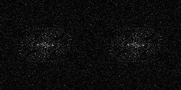

# SpeckleVision

**Hidden-scene structure from noisy speckle correlations.**

Explore the retained [Deep Inverse Correlography](NOTICE.md) implementation: a U-net maps a correlation image into an estimated scene. This edition adds setup guidance and bounded CPU verification records. The research model and sample inputs remain the original authors' work.



*Bundled sample input, shown as stored in the [retained source](NOTICE.md). Neither panel is a reconstructed scene. The demo consumes only the left half after resizing; no trained output is bundled.*

[Browse the inputs](#inspect-the-bundled-inputs) · [Follow the inference path](#what-the-demo-does) · [Run with trained weights](#trained-inference) · [Verification limits](VERIFICATION.md)

## Inspect the bundled inputs

You can inspect the data without a checkpoint or GPU. The three folders contain **96 grayscale PNGs**, each **254 × 127 pixels**:

| Retained input collection | Files | Browse |
| --- | --- | --- |
| Subsampled correlations; the default demo root | 28 | [`SubsampledData/test`](datasets/SubsampledData/test) |
| Short-exposure correlations | 28 | [`ShortExposureData/test`](datasets/ShortExposureData/test) |
| Simulated examples | 40 | [`SimData/test`](datasets/SimData/test) |

For a small executable input check, install Pillow in your Python environment and run this from the repository root:

```bash
python -m pip install Pillow
python - <<'PY'
from pathlib import Path
from PIL import Image

paths = sorted(Path('datasets').rglob('*.png'))
assert len(paths) == 96, f'Expected 96 bundled PNGs, found {len(paths)}'
for path in paths:
    with Image.open(path) as image:
        assert image.size == (254, 127) and image.mode == 'L', str(path)
        image.verify()
print('PASS: 96 grayscale input PNGs, each 254 x 127; no inference run')
PY
```

This checks the bundled files, not the model. A failed count or image check means the checkout differs from this input inventory; check the reported file or restore the missing sample before proceeding.

## What the demo does

[`demo.py`](demo.py) defines the exact path from a stored file to an output:

1. Load files through `ImageFolder`, keeping the collection's `test/` subfolder.
2. Resize each PNG to **256 wide × 128 high** and normalize the pixels.
3. Take channel 0 and the **left 128 columns** as a `1 × 1 × 128 × 128` network input. The stored right half is not a network prediction.
4. Run the loaded U-net, display its **central 64 × 64 crop**, and save that crop as `Reconstructions/0_recon.png`, `1_recon.png`, and so on.

The central crop is a display/output convention in this source, not the full network output. The [`network architecture`](utils/network.py), [`correlation utilities`](utils/xcorr2.py) and [`training-data generator`](create_training_data.m) are available for inspection.

<a id="inference"></a>

## Trained inference

The retained demo needs PyTorch, torchvision, matplotlib, Pillow, an **NVIDIA CUDA environment**, and the external checkpoint. It explicitly loads the checkpoint onto CUDA; the presence of a CPU fallback variable does not make this demo CPU-ready. Historical correlation utilities use `torch.rfft`/`torch.irfft`; full reproduction needs a compatible historical PyTorch environment.

1. Obtain the separately hosted [trained network](https://stanford.box.com/s/zyzdhzyk68xw6z8whpcup5cman55esl7) and place `TrainedNetwork.pth` in `checkpoints/`.
2. Keep `datasets/SubsampledData/` as the default input root, or select another collection root in `demo.py`.
3. From the repository root, run `python demo.py`.

The checkpoint download link is retained from the research source; its availability has not been verified. `checkpoints/` and `Reconstructions/` contain placeholders, not weights or results. A missing checkpoint or CUDA error means the prerequisites are incomplete; use the input inspection above while setting up the research environment.

## Training

Place the BSD-500 JPEG images directly in [`datasets/BSD500/`](datasets/BSD500), as expected by [`create_training_data.m`](create_training_data.m). The [BSD-500 source](https://www2.eecs.berkeley.edu/Research/Projects/CS/vision/grouping/resources.html) is external. Run the generator in MATLAB with its image-processing functions available, then `python train_network.py` in a compatible PyTorch environment. The generator writes `datasets/Edges_b80_gammap0.015_res64/`, the training script's default input root.

Model architecture, normalization, training defaults and sample data remain unchanged. [Raw speckle measurements](https://stanford.box.com/s/lta3jxsgrj49uio9v5qgko1betj8z77w) are referenced separately by the original project.

<a id="verification"></a>
<a id="source-and-license"></a>

## Evidence and source

The [verification record](VERIFICATION.md) describes a prior randomly initialized CPU network check. That check is not trained reconstruction or evidence of accuracy. No new trained inference, training or CUDA result is claimed here.

Based on [Deep Inverse Correlography](https://github.com/ricedsp/Deep_Inverse_Correlography/tree/b7f720fdeab6a028415710a87634e66d6f95e154) by **Christopher Metzler and the cited research collaborators**. [Source and additions](NOTICE.md) · [Original license](LICENSE) · [New-addition terms](LICENSE-branding) · [Third-party U-net terms](THIRD_PARTY_NOTICES.md).

Maintained by [nazeeh111](https://github.com/nazeeh111).
